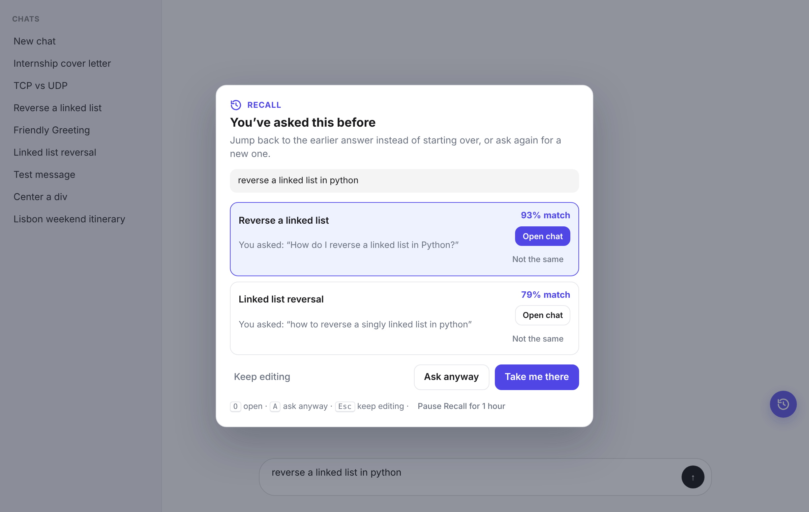
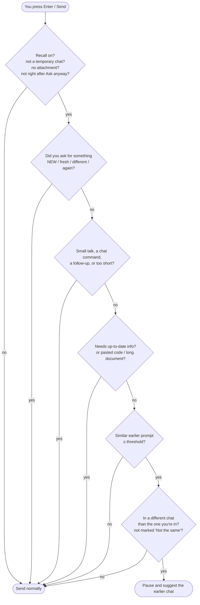
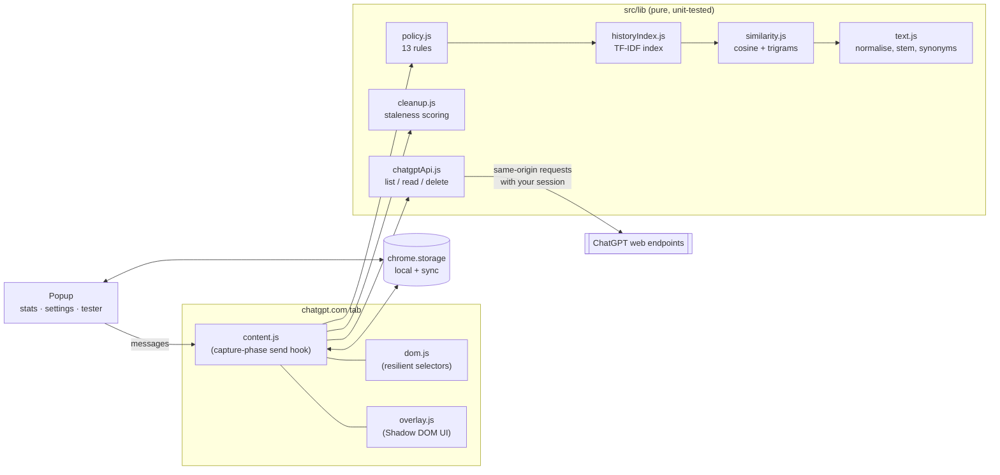

<div align="center">


# Recall

### Already asked that? Recall takes you straight back to the chat where you did.

A privacy-first browser extension for ChatGPT that catches repeat questions *before* you send them,<br/>
and clears out stale chats in a few clicks instead of one by one.

[](https://github.com/Anushka180712/Recall-API/actions/workflows/ci.yml)


[](LICENSE)



</div>

---

## Table of contents

- [Why Recall?](#why-recall)
- [Features](#features)
- [When does Recall step in? (and when doesn't it)](#when-does-recall-step-in-and-when-doesnt-it)
- [One-click chat cleanup](#one-click-chat-cleanup)
- [Install](#install)
- [How to use it](#how-to-use-it)
- [Settings](#settings)
- [How it works](#how-it-works)
- [Privacy and permissions](#privacy-and-permissions)
- [Development](#development)
- [Testing](#testing)
- [Limitations and FAQ](#limitations-and-faq)
- [Roadmap](#roadmap)
- [License](#license)

## Why Recall?

We all do it: you ask ChatGPT how to reverse a linked list, get a great answer, and three weeks later you ask
again from a brand-new chat. The old answer (and the follow-ups you already worked through) is still sitting in
your history, buried under hundreds of chats.

Recall remembers what you have asked. When you are about to repeat yourself, it pauses the send and shows you
the earlier conversation, so you can jump straight back to it. If you really do want a fresh answer, one click
(or simply saying "give me a new one") sends it as normal.

And because a history full of `New chat`, `Friendly Greeting` and six copies of the same question is what makes
finding things hard in the first place, Recall also offers to **clean those up in bulk**.

## Features

| | |
|---|---|
| 🔁 **Repeat detection** | Catches re-phrased questions, not just copy-pastes ("reverse linked list python" ≈ "How do I reverse a linked list in Python?"). |
| ↩️ **Redirect, don't re-ask** | Shows up to 3 earlier chats with a similarity score, the prompt you asked back then and when. *Take me there* opens it. |
| 🧠 **Knows when *not* to interrupt** | 13 explicit rules: never for "generate a new one", small talk, time-sensitive questions, follow-ups, attachments, temporary chats and more ([full list](#when-does-recall-step-in-and-when-doesnt-it)). |
| ✋ **You are always in control** | *Ask anyway*, *Not the same* (never suggests that chat for that question again), or *Keep editing*. Keyboard shortcuts `O` / `A` / `Esc`. |
| 🧹 **Bulk cleanup** | Finds untitled, greeting-only, duplicate and long-abandoned chats, explains why for each, and deletes the ones you tick, after a confirmation. |
| 🔔 **Gentle nudges** | At most once a week (configurable), and only if there are enough stale chats to bother: "You have 14 chats that look stale. Review?" |
| 📥 **Learns your history** | From prompts you send, chats you open, and (one click) your whole existing history. |
| 🧪 **"Would Recall step in?" tester** | Type any prompt in the popup and see the exact decision and the reason, live. |
| 🔒 **Private by design** | No servers, no analytics, no accounts. The index lives in `chrome.storage.local`. Export or wipe it any time. |
| 🌗 **Feels native** | Light and dark mode, reduced-motion support, accessible dialogs (focus management, ARIA roles, keyboard-only use). |

## When does Recall step in? (and when doesn't it)

Not every match deserves an interruption. Recall runs a fixed list of rules **in order, and the first rule
that applies decides**. Each decision has a reason code, which you can see in the popup's tester and which the
test suite checks one by one ([`tests/unit/policy.test.js`](tests/unit/policy.test.js)).



### ✅ Recall suggests a redirect when **all** of these are true

1. You're about to send a standalone question from a **new chat or a different chat**.
2. An earlier prompt of yours is at least **70 % similar** (the *Balanced* preset; *Loose* = 60 %, *Strict* = 82 %).
3. None of the "don't interrupt" rules below applies.

### 🚫 Recall stays out of the way when...

| # | Situation | Example | Reason code |
|---|---|---|---|
| 1 | Recall is switched off | | `disabled` |
| 2 | You just chose **Ask anyway** for this prompt | | `user-override` |
| 3 | You're in a **temporary chat** (also never stored) | `?temporary-chat=true` | `temporary-chat` |
| 4 | A **file or image is attached**, so the answer depends on it | | `has-attachments` |
| 5 | You **explicitly ask for something new**. Your words always win, even over an exact duplicate | "generate a **new** poem", "**another** one", "**different** recipe", "explain it **again**", "**fresh** take", "**regenerate**", "**from scratch**", "**don't redirect**", "**ask anyway**" | `wants-new-answer` |
| 6 | **Small talk or a chat command** | "hi", "thanks!", "continue", "go on", "tl;dr", "shorter" | `generic` |
| 7 | A **follow-up** that only makes sense in the open chat | "what about in Java?", "make it shorter", "rewrite the code you gave", "and in Go?" | `contextual-followup` |
| 8 | **Too short** to mean much (< 12 characters or < 3 meaningful words) | "python?" | `too-short` |
| 9 | It needs **up-to-date information**, so an old answer could be stale | "**latest** iPhone", "news **today**", "weather", "stock price", "best laptops **in 2026**". Everyday words like "current", "still" or "next month" do **not** count | `needs-fresh-info` |
| 10 | It contains **pasted code or a long document** (unique input) | anything with ```` ``` ```` or > 1,500 chars | `pasted-content` |
| 11 | Nothing earlier is **similar enough** | | `no-match` |
| 12 | The only similar question is **in the chat you're already in** (that's a follow-up, not a repeat) | | `same-conversation` |
| 13 | You said **"Not the same"** for that chat and this question (remembered for 30 days) | | `snoozed` |

> **Exact copies always count.** If you paste the exact text of something you asked in another chat (ignoring case and
> punctuation, however long it is), Recall offers that chat even if rules 7 to 10 would normally stay quiet. Only an
> explicit request for a new answer, small talk, attachments, temporary chats, the current chat, or switching Recall off
> beat an exact copy.

> **Tip:** start or end a prompt with "again", "new", "fresh take", or "ask anyway" to skip Recall for that
> one message, no clicks needed.

## One-click chat cleanup


Open it from the small round button on ChatGPT, from the popup, or from the weekly nudge. Each chat earns points
for signals that it's clutter, and anything with 2+ points is listed with its reasons:

| Signal | Points | Example |
|---|---|---|
| Never got a title | 3 | `New chat` |
| Only small talk | 3 | a chat that was just "hi" / "test", or titled `Friendly Greeting` |
| Same question as a **newer** chat (only the older copy is flagged) | 2 | two "reverse a linked list" chats |
| Not opened in a long time (default 60 days, configurable) | 2 | |
| Untouched for twice that long | +1 | |
| Single question, no follow-up | +1 | |

Chats with 3+ points are pre-ticked; you can untick anything, *Select all/none*, or **Keep selected** (Recall
never suggests those again). The chat you're currently in is never suggested.

**Deleting is always a two-step action.** Clicking *Delete N chats…* only opens a confirmation that spells out
what will happen; nothing is removed until you press **Yes, delete N**. Deletion runs one chat at a time with a
progress bar, a failure never stops the rest, and anything that couldn't be deleted is listed with a link so you
can remove it by hand.


## Install

> Works in Chrome, Edge, Brave, Arc, Opera and other Chromium browsers (version 110+), on `chatgpt.com` and
> `chat.openai.com`.

### Option A: Load from source (2 minutes)

1. **Download** this repository: click **Code → Download ZIP** and unzip it, or
   ```bash
   git clone https://github.com/Anushka180712/Recall-API.git
   ```
2. Open **`chrome://extensions`** (Edge: `edge://extensions`).
3. Turn on **Developer mode** (top-right toggle).
4. Click **Load unpacked** and select the folder that contains `manifest.json`.
5. Pin Recall from the 🧩 puzzle menu so its icon is always visible.
6. Open (or reload) **[chatgpt.com](https://chatgpt.com)**.

### Option B: Build the zip yourself

```bash
npm ci
npm run package        # -> dist/recall-1.0.0.zip
```

Every CI run also attaches this zip as a downloadable build artifact.

### First run

About four seconds after you open ChatGPT, Recall offers to **learn from your existing chats**. Say yes and it
reads your recent history so it can recognise repeats from day one. It's quick: chat titles are learned in about a second, then the
prompts inside up to 200 chats are read 6 at a time in the background (about 6 seconds for 200 chats in our tests). You can hide the
progress and keep chatting.
Say *Not now* and it will simply learn as you go. You can run the import later from the popup.


## How to use it

Just use ChatGPT. When you're about to repeat yourself, Recall pauses the send and shows:

| Action | What happens | Shortcut |
|---|---|---|
| **Take me there** / **Open chat** | Opens the earlier conversation. Your message is *not* sent. | `O` |
| **Ask anyway** | Sends your message right now, exactly as typed. | `A` |
| **Not the same** | Never suggests that chat for this question again (for 30 days), then continues. | |
| **Keep editing** | Closes the dialog and puts you back in the message box. Nothing is sent. | `Esc` |

<p align="center"></p>

The **popup** shows how many prompts and chats Recall knows, how many repeats you avoided and chats you cleaned,
a sensitivity switch, the **live tester**, and buttons to import history or open cleanup.

## Settings

All settings are in the popup and sync across your Chrome profile (the history itself never does).

| Setting | Default | What it does |
|---|---|---|
| Enabled | on | Master switch. Takes effect instantly in open tabs. |
| Sensitivity | Balanced (70 %) | Loose 60 % · Balanced 70 % · Strict 82 % similarity needed. |
| Skip time-sensitive questions | on | Rule 9 above. |
| Learn from chats I open | on | Index the prompts of any chat you view. |
| Remind me to clean up | on | Weekly nudge, only when 5+ chats look stale. *Don't ask again* turns it off. |
| Show the cleanup button | on | The small round button on ChatGPT. |
| Consider chats stale after | 60 days | Used by the cleanup scoring. |
| Export my data | | Downloads everything Recall stores as JSON. |
| Forget everything | | Wipes the index in every open tab (asks twice). |

## How it works



### The send hook

`content.js` listens for **Enter**, **send-button clicks** and **form submits** on `window` in the *capture*
phase, so it runs before ChatGPT's own handlers. The decision is synchronous and in-memory, using an inverted index so only prompts sharing a word are scored (a few milliseconds
even with thousands of prompts). If Recall intercepts, it calls `preventDefault()` and
`stopImmediatePropagation()` and shows the dialog; *Ask anyway* re-clicks the real send button with a one-shot
bypass flag. One physical send that surfaces as keydown + click + submit is handled exactly once.

### Matching repeats

1. **Normalise:** lower-case, strip accents, URLs and punctuation.
2. **Tokenise:** drop ~150 filler words ("can you please explain how..."), stem (`sorting → sort`,
   `libraries → library`) and fold synonyms (`summarise/summary/tl;dr`, `vs/difference/compare`, `js → javascript`).
3. **Score** = `0.7 × TF-IDF cosine(tokens) + 0.3 × Jaccard(character trigrams)`.
   - TF-IDF is computed over **your own** history, so words you use constantly ("python", "code") weigh less
     than the rare words that identify a topic ("kubernetes", "publickey").
   - Character trigrams make it robust to typos, plurals and word order (`cookeis` still matches).
4. **Group by chat:** only the best prompt per conversation counts; top 3 conversations are shown.

The threshold was tuned on a labelled set of paraphrases and look-alikes that the test suite pins down, e.g.
"*Explain TCP vs UDP*" ≈ "*difference between udp and tcp*" (**match**) while
"*Summarize 1984 by Orwell*" vs "*Summarize Animal Farm by Orwell*" (**no match**).

### Learning your history

| Source | When | Notes |
|---|---|---|
| Prompts you send | Always | Linked to the chat once ChatGPT assigns its id. |
| Chats you open | If *Learn from chats I open* is on | Reads the user messages on screen. |
| Import | When you click *Learn from my chats* | Two phases: titles of your recent chats are indexed instantly from one list call, then the prompts of up to 200 chats are fetched **6 in parallel** (with automatic back-off if ChatGPT rate-limits). Runs in the background, saves as it goes, and skips chats already learned on re-runs. |

The index keeps up to 5,000 prompts (60 per chat, 400 characters each), evicting the oldest first. Two open
ChatGPT tabs merge their changes instead of overwriting each other, and deletions are remembered so a stale
tab can't resurrect a deleted chat.

### Project layout

```
manifest.json               MV3 manifest (permissions: storage + chatgpt.com only)
src/
  lib/                      Pure logic, no DOM. Runs in the page, the popup and Node tests
    text.js                 normalise / tokenise / stem / synonyms / hash
    similarity.js           TF-IDF cosine + trigram Jaccard
    policy.js               the redirect rules (single source of truth)
    historyIndex.js         searchable, serialisable, mergeable prompt index
    cleanup.js              stale-chat scoring
    chatgptApi.js           list / read / delete chats (one place to fix if ChatGPT changes)
    store.js                chrome.storage persistence (injectable for tests)
    settings.js routes.js   defaults & validation, URL parsing
  content/
    content.js              wires everything to the page
    dom.js                  every ChatGPT selector, with fallbacks
    overlay.js              dialog, cleanup panel, toasts, launcher (Shadow DOM)
  popup/                    popup UI
  background/               tiny service worker (install defaults)
tests/
  unit/                     133 Node tests for src/lib
  e2e/                      9 real-browser tests (Chromium + the extension + a mock chat app)
  fixtures/mock-chat.html   the mock chat app used by e2e tests and screenshots
scripts/                    package, screenshots, icon generation
```

### Engineering choices

- **Zero runtime dependencies and no build step.** What's in `src/` is exactly what runs, which makes the
  extension easy to audit. A 20-line module shim lets the same files load as content scripts, popup scripts and
  CommonJS modules for tests.
- **Shadow DOM UI, text-only rendering.** ChatGPT's CSS can't break Recall's UI, and prompts/titles are always
  inserted with `textContent`, never `innerHTML`.
- **Fail open.** If anything goes wrong, Recall lets the message through. It never blocks you from using ChatGPT.
- **Isolated fragility.** All page selectors live in `dom.js` and all endpoint knowledge in `chatgptApi.js`, each
  with fallbacks and clear errors.
- **Least privilege.** Only the `storage` permission plus host access to ChatGPT. No `tabs`, `history`,
  `cookies`, `<all_urls>` or remote code; strict extension-page CSP.

## Privacy and permissions

- 🔒 **Everything stays on your device.** The prompt index, stats and snoozes live in `chrome.storage.local`.
  Only your settings (a handful of numbers and toggles) use `chrome.storage.sync`.
- 🚫 **No servers, no analytics, no tracking.** Recall makes no network requests of its own. The import and
  cleanup features talk only to ChatGPT, from your ChatGPT tab, using your existing session, exactly like the
  ChatGPT website does.
- 🕶️ **Temporary chats are never stored.**
- 🧾 **Your data, your call.** *Export my data* downloads it all as JSON; *Forget everything* wipes it;
  uninstalling the extension removes it.

| Permission | Why |
|---|---|
| `storage` | Save your settings and the local prompt index. |
| `https://chatgpt.com/*`, `https://chat.openai.com/*` | Run on ChatGPT (and only there). |

See [PRIVACY.md](PRIVACY.md) for the full policy.

## Development

Requirements: Node.js 20+ and a Chromium browser.

```bash
git clone https://github.com/Anushka180712/Recall-API.git
cd Recall-API
npm ci

npm test               # unit tests (fast, no browser)
npm run test:e2e       # real-browser tests (needs Chromium, see below)
npm run lint           # ESLint
npm run coverage       # unit tests with coverage report
npm run package        # build dist/recall-<version>.zip
npm run screenshots    # regenerate docs/images
```

Load the folder as an unpacked extension (see [Install](#install)) and hit the ↻ reload button on
`chrome://extensions` after each change.

## Testing

**142 automated tests** run on every push via GitHub Actions.

| Suite | Count | What it covers |
|---|---|---|
| `tests/unit/policy.test.js` | 50 | Every redirect / no-redirect rule from the table above, exact copies (including very long ones), rule priority ("new answer" beats an exact duplicate), snoozes, thresholds. |
| `tests/unit/similarity.test.js` | 23 | Labelled paraphrases must match; same-template, different-topic pairs must not. |
| `tests/unit/historyIndex.test.js` | 16 | Search ranking, IDF, caps, eviction, cross-tab merge, deletions, wipe. |
| `tests/unit/cleanup.test.js` | 10 | Each staleness signal, duplicates, protected/open chats, malformed input. |
| `tests/unit/chatgptApi.test.js` | 12 | Parallel paging, concurrency limits, 429 back-off, prompt extraction, token refresh, partial delete failures. |
| `tests/unit/store.test.js`, `settings`, `routes`, `text` | 22 | Persistence, validation, URL parsing, tokenisation. |
| `tests/e2e/extension.test.js` | 9 | **Real Chromium with the extension loaded** against a mock chat app: redirect, Ask anyway, Esc, explicit "new answer", small talk, fresh info, same-chat follow-ups, *Not the same*, import, passive learning, bulk delete with confirmation, popup tester and *Last message* explanation, on/off switch, an exact pasted copy of a long opening prompt, and a **speed test**: importing 200 chats from a deliberately slow server must finish in under 15 s. |

The end-to-end tests serve a small mock chat app ([`tests/fixtures/mock-chat.html`](tests/fixtures/mock-chat.html))
on `https://chatgpt.com` via Playwright request routing, so no real account or network is involved. To run them
locally:

```bash
npx playwright install chromium
npm run test:e2e
# or point at an existing Chromium:
CHROMIUM_PATH=/path/to/chrome npm run test:e2e
```

## Limitations and FAQ

**Where does Recall show up, and how do I check it's working?** When it steps in, a dialog appears in the middle
of the ChatGPT page *instead of* your message being sent. To see what happened with any message, click the Recall
icon in the toolbar: **Last message you sent** says whether Recall checked it and, if it let it through, exactly
why. You can also type any prompt into **Would Recall step in?** to test it without sending. If *Last message* never
updates after you send something, reload the ChatGPT tab (needed once after installing or updating Recall).

**ChatGPT changed its layout and Recall stopped working?** ChatGPT's markup changes often. All selectors are in
[`src/content/dom.js`](src/content/dom.js) with several fallbacks each. If sending is never intercepted, that's
the file to update. Recall fails open, so ChatGPT itself keeps working.

**Import or cleanup says it couldn't reach my chat list.** Those features use the same (unofficial) endpoints as
the ChatGPT website, which can change. When they're unavailable, the redirect feature still works from prompts you
send and chats you open, and cleanup falls back to the chats in your sidebar with links to delete them by hand.

**Does it understand other languages?** Matching works on any script (accents are normalised), but the filler-word
list, stemming and the "new answer / fresh info" rules are English-first.

**Will it ever send my message without me?** No. Recall only ever *holds back* a send; it re-sends only when you
press *Ask anyway* or *Not the same*.

**Is this affiliated with OpenAI?** No. Recall is an independent, open-source project. ChatGPT is a trademark of
OpenAI.

## Roadmap

- [ ] Firefox (MV3) build
- [ ] Optional on-device semantic embeddings for even better paraphrase matching
- [ ] "Search my past prompts" command palette
- [ ] Archive instead of delete as a cleanup option
- [ ] Multi-language filler-word and intent lists

## License

[MIT](LICENSE) © 2026 Anushka180712
