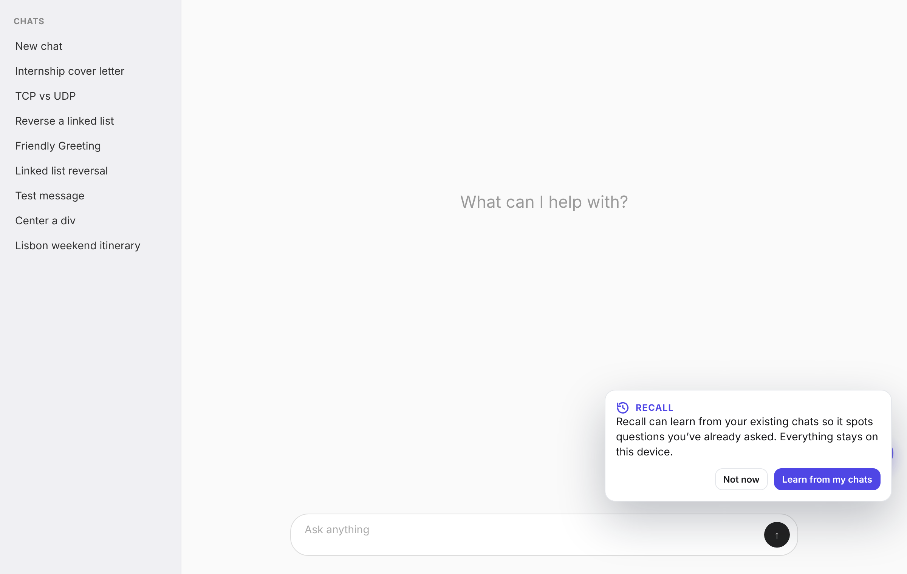
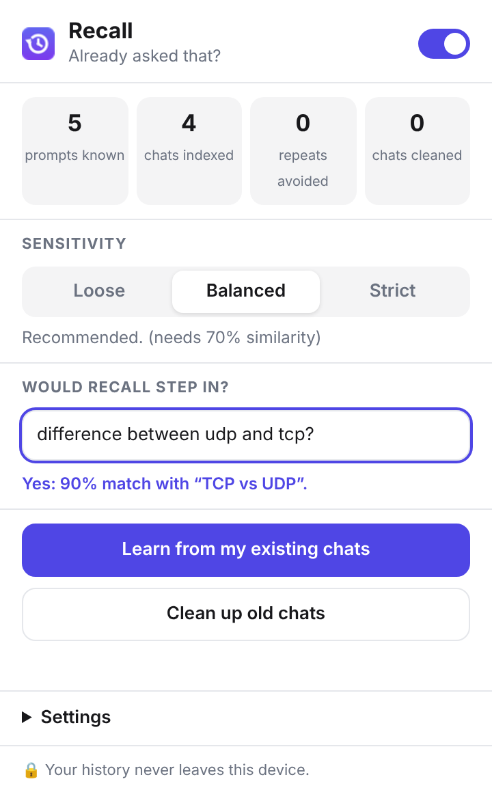
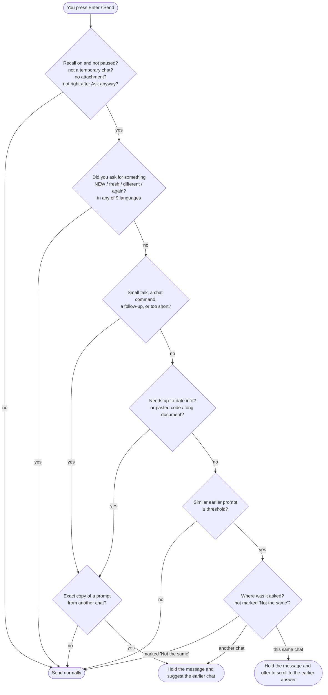
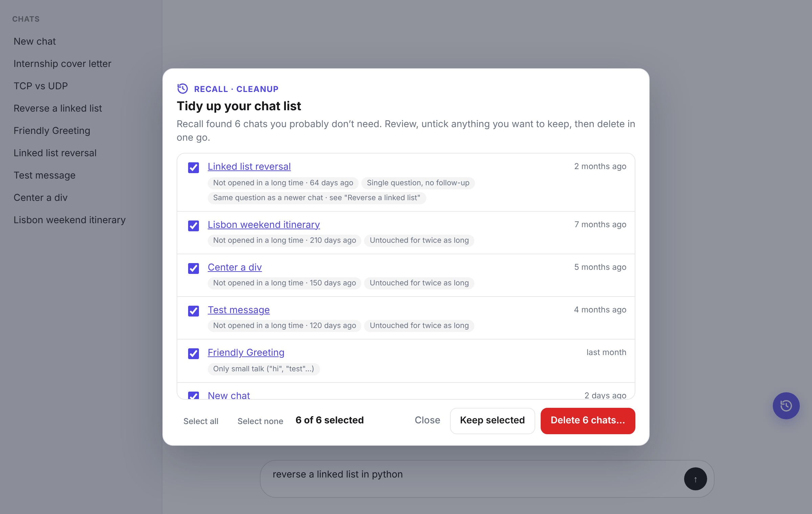
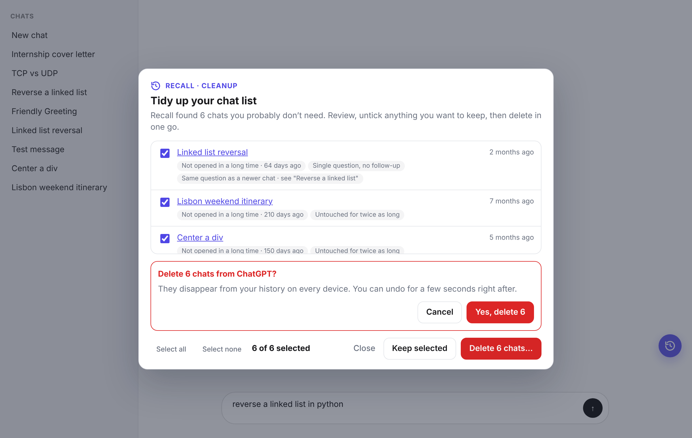
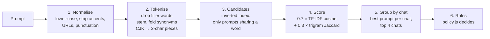
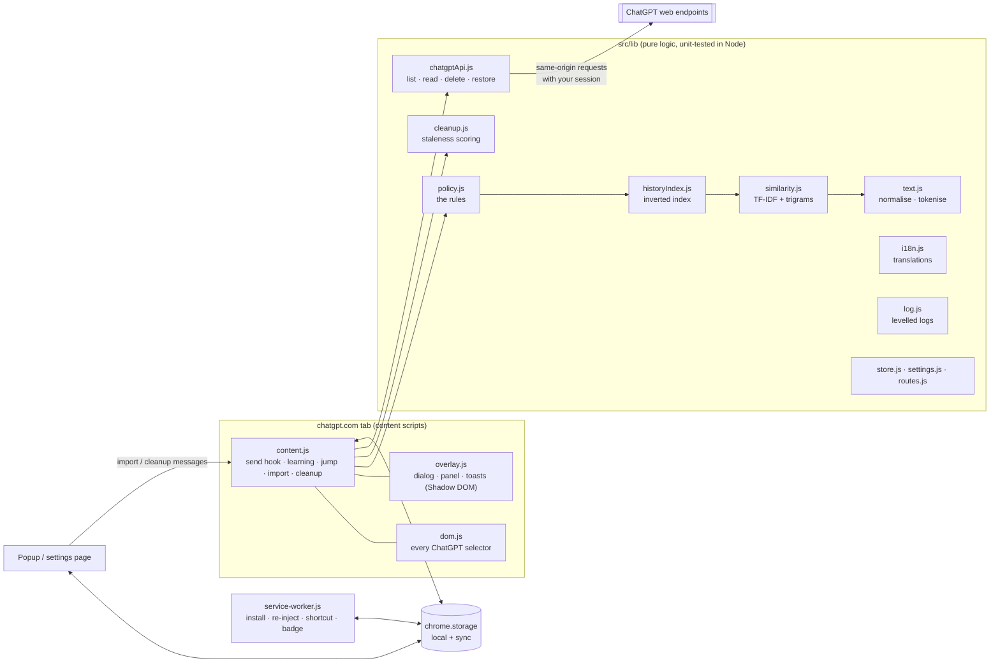
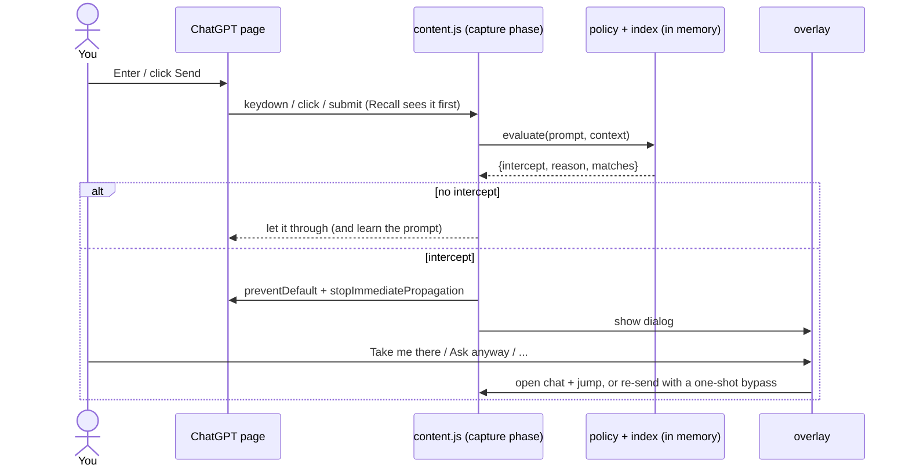

<div align="center">


# Recall

### Already asked that? Recall takes you straight back to the chat where you did.

A privacy-first browser extension for ChatGPT that catches repeat questions *before* you send them,<br/>
and clears out stale chats in a few clicks instead of one by one.

[](https://github.com/Anushka180712/Recall-API/actions/workflows/ci.yml)


[](LICENSE)


</div>

---

> **Read this once and you know everything.** This page covers what Recall does, how to install and use it, exactly
> when it steps in and when it doesn't, how the matching works (and why there is no AI model inside), the
> architecture file by file, logging, privacy, testing, and a long FAQ. Jump around with the contents below.

## Table of contents

1. [Why Recall?](#why-recall)
2. [Features at a glance](#features-at-a-glance)
3. [Install (2 minutes)](#install-2-minutes)
4. [How to use it](#how-to-use-it)
5. [When does Recall step in? (and when doesn't it)](#when-does-recall-step-in-and-when-doesnt-it)
6. [One-click chat cleanup (with undo)](#one-click-chat-cleanup-with-undo)
7. [Settings](#settings)
8. [How matching works: the "model"](#how-matching-works-the-model)
9. [Architecture](#architecture)
10. [Languages](#languages)
11. [Logging and debugging](#logging-and-debugging)
12. [Privacy and permissions](#privacy-and-permissions)
13. [Tech stack](#tech-stack)
14. [Development](#development)
15. [Testing](#testing)
16. [Releasing](#releasing)
17. [FAQ and troubleshooting](#faq-and-troubleshooting)
18. [Design decisions and trade-offs](#design-decisions-and-trade-offs)
19. [Roadmap](#roadmap)
20. [License](#license)

## Why Recall?

We all do it: you ask ChatGPT how to reverse a linked list, get a great answer, and three weeks later you ask
again from a brand-new chat. The old answer (and the follow-ups you already worked through) is still sitting in
your history, buried under hundreds of chats.

Recall remembers what you have asked. When you are about to repeat yourself, it holds the message back and shows
you the earlier conversation, then takes you to **the exact message** where you asked it. If you really do want a
fresh answer, one click (or simply saying "give me a new one", "otra vez", "phir se"...) sends it as normal.

And because a history full of `New chat`, `Friendly Greeting` and six copies of the same question is what makes
finding things hard in the first place, Recall also offers to **clean those up in bulk**, with an undo.

## Features at a glance

| | |
|---|---|
| 🔁 **Repeat detection** | Catches re-phrased questions, not just copy-pastes ("reverse linked list python" ≈ "How do I reverse a linked list in Python?"). Exact copies always count. |
| 📋 **Pick the right chat** | When several earlier chats are similar, up to 4 are listed best first, each with its title, the prompt you asked, the match % and when. Open whichever you want. |
| 🎯 **Takes you to the exact message** | *Take me there* (or *Open chat* on any listed chat) opens it, loads older messages if needed, scrolls to **the message you asked**, outlines it and labels it "You asked this here". |
| 🧠 **Knows when *not* to interrupt** | 14 explicit rules: never for "generate a new one" (in 9 languages), small talk, time-sensitive questions, follow-ups, attachments, temporary chats and more ([full list](#when-does-recall-step-in-and-when-doesnt-it)). |
| 🔂 **No repeats inside a chat either** | Repeat a question in the same chat and Recall offers *Show me the answer* (scrolls up to it) instead of generating it again. |
| ✋ **You're always in control** | *Ask anyway*, *Not the same*, *Keep editing*, **Pause for 1 hour**, an on/off switch and a **keyboard shortcut** (`Alt+Shift+R`). |
| 🧹 **Bulk cleanup with undo** | Finds untitled, greeting-only, duplicate and long-abandoned chats, explains why, deletes the ones you tick after a confirmation, and offers **Undo** right after. |
| 🌍 **Made for everyone** | UI in English, Spanish, French, German, Hindi and Portuguese (follows your browser). Matching works in any script, including Hindi, Chinese, Japanese and Korean. |
| 🩺 **Tells you when something's off** | If ChatGPT changes its page and Recall can't find the message box, the popup says so plainly. Recall never blocks sending. |
| 🧪 **"Would Recall step in?" tester** | Type any prompt in the popup and see the decision and the reason, live. *Last message you sent* explains what happened to your latest message. |
| 🔒 **Private by design** | No servers, no analytics, no accounts, no AI service. Everything stays in your browser. Export or wipe it any time. |
| ♿ **Accessible** | Keyboard-only use, focus stays inside dialogs, ARIA roles, light/dark mode, reduced-motion support. |

## Install (2 minutes)

Works in **Chrome, Edge, Brave, Opera, Vivaldi, Arc** (Chromium 110+), and experimentally in **Firefox 115+**, on
`chatgpt.com` and `chat.openai.com`.

### Option A: load from source

1. **Download** this repository: click **Code → Download ZIP** and unzip it, or
   ```bash
   git clone https://github.com/Anushka180712/Recall-API.git
   ```
2. Open your browser's extensions page:
   `chrome://extensions` · `edge://extensions` · `brave://extensions` · `opera://extensions`
3. Turn on **Developer mode** (a toggle near the top).
4. Click **Load unpacked** and pick the folder that contains `manifest.json`.
5. Pin Recall from the 🧩 puzzle menu so its icon is always visible.
6. Open **[chatgpt.com](https://chatgpt.com)**. Tabs that were already open are picked up automatically.

### Option B: build the zips

```bash
npm ci
npm run package
# dist/recall-1.1.0.zip          Chrome, Edge, Brave, Opera...
# dist/recall-1.1.0-firefox.zip  Firefox (experimental)
```

Every CI run also attaches the Chrome zip as a downloadable build artifact.

### Firefox (experimental)

Run `npm run package`, open `about:debugging#/runtime/this-firefox`, click **Load Temporary Add-on…** and pick
`dist/recall-1.1.0-firefox.zip`. Then open the add-on's permissions (🧩 menu → Recall → *Manage*) and allow access
to chatgpt.com, because Firefox asks for site access separately.

### First run

A moment after you open ChatGPT, Recall offers to **learn from your existing chats**. Say yes and it reads your
recent history so it recognises repeats from day one. Chat titles are learned in about a second, then the prompts
inside up to 200 chats are read 6 at a time in the background (about 6 seconds for 200 chats in our tests). You can
hide the progress and keep chatting. Say *Not now* and it simply learns as you go; you can import later from the popup.



## How to use it

Just use ChatGPT. When you're about to repeat yourself, Recall holds the message back and shows:

| Action | What happens | Key |
|---|---|---|
| **Take me there** / **Open chat** | Opens the earlier chat, scrolls to the matching message, outlines it and labels it. Your message is *not* sent. | `O` |
| **Show me the answer** (same chat) | Scrolls up to where you asked it in this chat, highlights it and clears the repeated draft. Nothing is sent. | `O` |
| **Ask anyway** | Sends your message right now, exactly as typed. | `A` |
| **Not the same** | Never suggests that chat for this question again (for 30 days), then continues. | |
| **Keep editing** | Closes the dialog and puts you back in the message box. Nothing is sent. | `Esc` |
| **Pause Recall for 1 hour** | Sends your message and stops checking for an hour. Resume early from the popup. | |

`Tab` / `Shift+Tab` move between the buttons and never leave the dialog.

<p align="center"></p>

The **popup** (click the toolbar icon) has:

- stats: prompts known, chats indexed, repeats avoided, chats cleaned;
- an **on/off switch** (also `Alt+Shift+R`; the icon shows **OFF** while it's off) and **Pause for 1 hour**;
- a **sensitivity** switch (Loose / Balanced / Strict);
- **Last message you sent**: whether Recall checked your latest message, and why it did or didn't step in;
- **Would Recall step in?**: type anything to test it without sending;
- **Learn from my existing chats** and **Clean up old chats**;
- **Settings**, and a link to the **full settings page** (also under the extension's *Options*).

Change the shortcut at `chrome://extensions/shortcuts`.

## When does Recall step in? (and when doesn't it)

Not every match deserves an interruption. Recall runs a fixed list of rules **in order, and the first rule that
applies decides**. Each decision has a reason code, which you can see in the popup and which the tests check one
by one ([`tests/unit/policy.test.js`](tests/unit/policy.test.js)). The rules live in one file,
[`src/lib/policy.js`](src/lib/policy.js).



### ✅ Recall steps in when all of these are true

1. You're about to send a question you already asked, **in another chat or earlier in this same chat**.
2. An earlier prompt is at least **70 % similar** (*Balanced*; *Loose* = 60 %, *Strict* = 82 %), or it's an exact copy.
3. None of the "stay out of the way" rules below applies.

### 🚫 Recall stays out of the way when...

| # | Situation | Example | Reason code |
|---|---|---|---|
| 1 | Recall is switched off | | `disabled` |
| 2 | Recall is **paused** (Pause for 1 hour) | | `paused` |
| 3 | You just chose **Ask anyway** for this prompt | | `user-override` |
| 4 | You're in a **temporary chat** (also never stored) | `?temporary-chat=true` | `temporary-chat` |
| 5 | A **file or image is attached**, so the answer depends on it | | `has-attachments` |
| 6 | You **explicitly ask for something new**. Your words always win, even over an exact duplicate | "generate a **new** poem", "**another** one", "explain it **again**", "**regenerate**", "**from scratch**", "**don't redirect**", "**otra vez**", "**encore une fois**", "**noch mal**", "**de novo**", "**phir se**", "**dobara**", "**重新回答**", "**もう一度**", "**다시**" | `wants-new-answer` |
| 7 | **Small talk or a chat command** | "hi", "thanks!", "continue", "tl;dr", "gracias", "merci", "danke", "shukriya", "नमस्ते", "谢谢" | `generic` |
| 8 | A **follow-up** that only makes sense in the open chat | "what about in Java?", "make it shorter", "rewrite the code you gave", "and in Go?" | `contextual-followup` |
| 9 | **Too short** to mean much (< 12 characters or < 3 meaningful words) | "python?" | `too-short` |
| 10 | It needs **up-to-date information**, so an old answer could be stale | "**latest** iPhone", "news **today**", "weather", "stock price", "best laptops **in 2026**". Words like "current", "still" or "next month" do **not** count | `needs-fresh-info` |
| 11 | It contains **pasted code or a long document** (unique input) | anything with ```` ``` ```` or > 1,500 characters | `pasted-content` |
| 12 | Nothing earlier is **similar enough** | | `no-match` |
| 13 | You said **"Not the same"** for that chat and this question (remembered 30 days) | | `snoozed` |
| 14 | Recall can't find ChatGPT's message box (page changed) | | *(fails open; popup shows a warning)* |

> **Exact copies always count.** If you paste the exact text of something you asked in another chat (ignoring case
> and punctuation, however long it is), Recall offers that chat even if rules 8 to 11 would normally stay quiet. Only
> an explicit request for a new answer, small talk, attachments, temporary chats, pausing or switching Recall off
> beat an exact copy. Inside the same chat, short follow-ups like "make it shorter" can be repeated freely.

> **Tip:** add "again", "new", "fresh take" or "ask anyway" (or the same in your language) to skip Recall for one
> message, no clicks needed.

## One-click chat cleanup (with undo)



Open it from the small round button on ChatGPT, from the popup, or from the weekly nudge. Each chat earns points
for signals that it's clutter, and anything with 2+ points is listed with its reasons
([`src/lib/cleanup.js`](src/lib/cleanup.js)):

| Signal | Points | Example |
|---|---|---|
| Never got a title | 3 | `New chat` |
| Only small talk | 3 | a chat that was just "hi" / "test", or titled `Friendly Greeting` |
| Same question as a **newer** chat (only the older copy is flagged) | 2 | two "reverse a linked list" chats |
| Not opened in a long time (default 60 days) | 2 | |
| Untouched for twice that long | +1 | |
| Single question, no follow-up | +1 | |

Chats with 3+ points are pre-ticked. Untick anything, use *Select all/none*, or **Keep selected** (never suggested
again). The chat you're in is never suggested.

**Deleting is a two-step action**: *Delete N chats…* only opens a confirmation; nothing is removed until you press
**Yes, delete N**. Deletion runs a few chats at a time with a progress bar, one failure never stops the rest, and
anything that couldn't be deleted is listed with the reason and a link.

**Undo.** ChatGPT's own "delete" hides a chat rather than erasing it at once, so for a minute after deleting Recall
shows **Undo**, which makes those chats visible again. If ChatGPT refuses, Recall says so honestly.



## Settings

Settings sync across your browser profile (your history never does). Find them in the popup under **Settings**, or
on the full settings page (*Options*).

| Setting | Default | What it does |
|---|---|---|
| Enabled | on | Master switch, also `Alt+Shift+R`. Takes effect instantly in open tabs. |
| Pause for 1 hour | | Stops checks for an hour without switching off. *Resume now* ends it early. |
| Sensitivity | Balanced (70 %) | Loose 60 % · Balanced 70 % · Strict 82 % similarity needed. |
| Skip time-sensitive questions | on | Rule 10 above. |
| Learn from chats I open | on | Index the prompts of any chat you view. |
| Remind me to clean up | on | Weekly nudge, only when 5+ chats look stale. *Don't ask again* turns it off. |
| Show the cleanup button | on | The small round button on ChatGPT. |
| Consider chats stale after | 60 days | Used by the cleanup scoring. |
| Debug logging | off | Verbose console logs including prompt text. See [Logging](#logging-and-debugging). |
| Export my data | | Downloads everything Recall stores as JSON. |
| Forget everything | | Wipes the index in every open tab (asks twice). |

## How matching works: the "model"

**There is no AI or machine-learning model inside Recall**, and no call to any AI service. Matching is classic,
deterministic information retrieval written in about 250 lines of plain JavaScript
([`text.js`](src/lib/text.js), [`similarity.js`](src/lib/similarity.js), [`historyIndex.js`](src/lib/historyIndex.js)).
It runs in your browser in a few milliseconds and gives the same answer every time, which makes it testable and explainable.

### The pipeline



1. **Normalise.** Lower-case, Unicode-normalise (NFKD then NFC), strip accents (`qué → que`), replace URLs, turn
   punctuation into spaces. Letters and combining marks of every script are kept, so Hindi words stay whole.
2. **Tokenise.**
   - Drop about 300 filler words in English, Spanish, Portuguese, French, German and Hindi/Hinglish ("can you please
     explain…", "¿qué es…", "kya hai…").
   - Light stemming for Latin-script words (`sorting → sort`, `libraries → library`, `reverse / reversed / reversing → revers`).
   - Fold synonyms and abbreviations (`summarise / summary / tl;dr`, `vs / difference / compare`, `js → javascript`).
   - Chinese, Japanese and Korean have no spaces, so they are split into overlapping 2-character pieces
     (`什么是闭包 → 闭包`), the standard trick in CJK search.
3. **Find candidates.** An inverted index maps each token to the prompts that contain it, so only prompts that
   share at least one word are scored. A separate hash map finds **exact copies** instantly (full text, any length).
4. **Score** each candidate between 0 and 1:

   `score = 0.7 × cosine(TF-IDF vectors) + 0.3 × Jaccard(character trigrams)`

   - **TF-IDF cosine**: shared meaningful words, where a word's weight is its inverse document frequency over
     *your own* history, `idf = log((N + 1) / (df + 1)) + 1` (df floored at 1). Words you use all the time
     ("python", "code") weigh less than the rare words that pin down a topic ("kubernetes", "publickey").
   - **Character-trigram Jaccard**: overlap of 3-letter chunks of the normalised text, so typos, plurals and word
     order barely matter (`cookeis` still matches `cookies`).
   - An exact copy scores 1.
5. **Group by chat.** Only the best prompt per conversation counts; the top 4 conversations are shown, best first.
6. **Apply the rules** in [the table above](#-recall-stays-out-of-the-way-when) and compare to the threshold.

### Thresholds

| Preset | Score needed | Feels like |
|---|---|---|
| Loose | 0.60 | Catches more re-phrasings, occasionally a near miss. |
| **Balanced** (default) | **0.70** | Recommended. |
| Strict | 0.82 | Only near-identical questions. |

The weights (0.7 / 0.3) and the threshold were tuned on a labelled set of paraphrases and look-alikes that the
tests pin down ([`tests/unit/similarity.test.js`](tests/unit/similarity.test.js)), for example:

| Pair | Result |
|---|---|
| "Explain TCP vs UDP" ↔ "what is the difference between udp and tcp" | ✅ match |
| "recipe for chocolate chip cookies" ↔ "chocolate chip cookeis recipe" | ✅ match |
| "Summarize 1984 by Orwell" ↔ "Summarize Animal Farm by Orwell" | ❌ different topic |
| "什么是JavaScript中的闭包？" ↔ "JavaScript中的闭包是什么" | ✅ match |

### Why not embeddings or a language model?

| | This approach | Embedding / LLM |
|---|---|---|
| Privacy | Nothing leaves the browser | Needs a server, or a large on-device model |
| Speed | A few ms per check, synchronous (needed to stop a send in time) | Tens to hundreds of ms, usually async |
| Size | ~30 KB of code, zero dependencies | Tens to hundreds of MB |
| Explainability | Score is two readable numbers; rules have reason codes | Opaque similarity |
| Weakness | Paraphrases that share no words ("car" vs "automobile") need the synonym list | Handles these better |

For "did I already ask this?", the same person usually re-uses the same key words, so lexical matching gets most
of the benefit at a tiny fraction of the cost. An optional on-device embedding mode is on the roadmap.

### Limits of the index

Up to 5,000 prompts (60 per chat, first 400 characters each, plus a hash of the full text for exact copies). The
oldest are evicted first, in batches. Two open ChatGPT tabs merge their changes instead of overwriting each other,
and deleted chats are remembered so a stale tab can't bring them back.

## Architecture

### Components



There is **no build step**: the files in `src/` are exactly what the browser runs. A 20-line shim
([`umd.js`](src/lib/umd.js)) lets every library load as a content script, a popup script, a background script and
a CommonJS module for Node tests.

### Data flow: checking a message before it's sent



The check is synchronous and in memory: once the handler returns, ChatGPT's own handler runs, so there is no time
for async work. One physical send that surfaces as keydown + click + submit is handled exactly once.

### Data flow: "Take me there"

The matching logic is pure and unit-tested in [`src/lib/jump.js`](src/lib/jump.js); the page work is in `content.js`.

1. The target is saved in `sessionStorage` (survives in-app navigation and a full page load): the chat id, the
   earlier prompt that matched, **what you just typed**, and whether the match came from the chat's *title*.
2. In the background Recall asks ChatGPT for that chat's messages and picks the one you meant. That gives it
   ChatGPT's own **message id** and the message's full text.
3. It opens the chat through the sidebar link (no reload), or a normal navigation if the link isn't there.
4. Messages from the chat you just left are ignored, because ChatGPT keeps them on screen for a moment.
5. As soon as an element with that **`data-message-id`** appears, that's the one. Otherwise, once the messages
   stop changing for 700 ms, it matches by text: exact (or the start of a long message) first, then similarity to
   the earlier prompt *and* to what you typed. A match that came from the chat's title still lands on the message
   that best fits your question.
6. If it isn't rendered yet, it scrolls the chat to the top so older messages load, and keeps going while new ones appear.
7. It scrolls the message's turn to the **middle** of the view (clear of ChatGPT's sticky top bar), outlines it,
   pins a "You asked this here" label, and puts it back for 4 seconds because ChatGPT jumps to the bottom after
   loading. It stops as soon as you scroll or type. If it truly can't find the message, it says so instead of
   leaving you guessing.

### Data flow: import

1. One call lists your recent chats; titles are indexed straight away, so Recall is useful within a second or two.
2. The prompts inside each chat are fetched **6 at a time**, with automatic back-off on HTTP 429.
3. Progress is saved every 25 chats; chats already learned and unchanged are skipped on later runs.

### Data flow: cleanup and undo

1. List chats (cached for 2 minutes), add the prompts Recall knows, score them (`cleanup.suggest`).
2. You tick and confirm, then each chat is hidden with `PATCH is_visible:false`, 3 at a time. A 404 counts as done.
3. **Undo** sends `PATCH is_visible:true` for the chats just deleted.
4. The index forgets deleted chats and records a tombstone so other tabs don't re-add them.

### What is stored, and where

| Key | Area | Contents |
|---|---|---|
| `recall.settings` | `sync` | Settings only (numbers and toggles). |
| `recall.index` | `local` | Prompt index: per prompt the chat id, text (≤ 400 chars), time, source, full-text hash; chat titles; tombstones. |
| `recall.snoozes` | `local` | "Not the same" choices, with expiry. |
| `recall.stats` | `local` | Counters shown in the popup. |
| `recall.meta` | `local` | First-run flags, last nudge, pause end time, last health check. |
| `recall.protected` | `local` | Chats you chose to keep. |
| `recall.lastDecision` | `local` | The last check (reason, first 80 chars of the prompt) for the popup. |

### Staying alive when things change

- **Every send is checked, every time.** The listeners sit on `window` in the capture phase and look up the message
  box and send button at the moment you press them, so ChatGPT re-drawing its page or switching chats can't detach
  them. *Ask anyway* covers exactly one send. A bug inside a check is caught and the message goes through (fail open).
- **Newest copy wins.** If Recall is injected into a tab again (after an update), the new copy starts and tells the
  old one to step aside; there is never a tab with no working copy, and never two dialogs.
- **Switching chats:** the previous chat's messages stay on screen for a moment after the URL changes. Recall ignores
  them, so they're never learned as, or matched against, the new chat.
- **Extension updated or reloaded** while ChatGPT is open: the old copy notices ("Extension context invalidated"),
  removes its listeners and steps aside. The service worker injects the new copy into open tabs; if that isn't
  possible, a toast offers **Reload page**. ChatGPT keeps working either way.
- **ChatGPT changes its page**: every selector lives in [`dom.js`](src/content/dom.js) with fallbacks. A health
  check records whether the message box was found, and the popup warns you if not. Recall **fails open**: it
  never blocks a send because something is missing.
- **ChatGPT changes its endpoints**: all endpoint knowledge lives in [`chatgptApi.js`](src/lib/chatgptApi.js) with
  readable errors (signed out, rate-limited, refused...). The redirect feature keeps working without it.

### File-by-file map

```
manifest.json                 MV3 manifest: permissions, content scripts, shortcut, options page, locales
_locales/<lang>/messages.json UI text in en, es, fr, de, hi, pt_BR (generated by scripts/locales.py)
src/
  lib/                        Pure logic, no DOM. Runs in the page, popup, background and Node tests
    umd.js                    module shim (RecallDefine) so files load without a bundler
    i18n.js                   t(key, fallback, subs) and translatePage() on top of chrome.i18n
    log.js                    levelled, structured logging with prompt redaction and a ring buffer
    text.js                   normalise, tokenise (multilingual filler words, stemming, synonyms, CJK), hash
    similarity.js             TF-IDF cosine + character-trigram Jaccard
    jump.js                   which message is "the one" for Take me there (message id, text, similarity)
    policy.js                 the rules: when to step in and why (single source of truth)
    historyIndex.js           searchable, serialisable, mergeable prompt index (inverted index + exact map)
    cleanup.js                stale-chat scoring and reasons
    chatgptApi.js             list / read / delete / restore chats; concurrency, retries, friendly errors
    store.js                  chrome.storage persistence: settings, index, snoozes, stats, pause, health
    settings.js               defaults, presets and validation
    routes.js                 URL parsing (chat id, temporary chats)
  content/
    content.js                wires everything to the page: send hook, learning, jump, import, cleanup
    dom.js                    every ChatGPT selector, with fallbacks
    overlay.js                dialog, cleanup panel, toasts, label, launcher (Shadow DOM, translated)
  popup/                      popup + full settings page (popup.html?options=1)
  background/service-worker.js  defaults on install, re-inject after update, shortcut, OFF badge
tests/
  unit/                       164 Node tests for src/lib, translations and the manifest
  e2e/                        22 real-browser tests (Chromium + the extension + a mock chat app)
  fixtures/mock-chat.html     mock chat app used by the e2e tests and screenshots
scripts/
  package.js                  builds the Chrome and Firefox zips
  locales.py                  source of truth for translations
  screenshots.js              regenerates docs/images
  make-icons.py               draws the icons
docs/store-listing.md         ready-to-paste Chrome Web Store / Edge Add-ons listing
```

## Languages

| | Languages |
|---|---|
| **Interface** | English, Español, Français, Deutsch, हिन्दी, Português (Brasil). Follows your browser's language; anything untranslated falls back to English. |
| **"Give me a new answer" and small talk** | English, Spanish, Portuguese, French, German, Hindi (Devanagari and Hinglish), Chinese, Japanese, Korean. |
| **Filler words** | English, Spanish, Portuguese, French, German, Hindi/Hinglish. |
| **Matching** | Any language and script. Accents are normalised; CJK is split into 2-character pieces. |

Adding a language: add a column to [`scripts/locales.py`](scripts/locales.py), run `python3 scripts/locales.py`,
and `npm test` checks every key and placeholder is present.

## Logging and debugging

Recall uses a small levelled logger ([`src/lib/log.js`](src/lib/log.js)). Every line is tagged with where it came from:

```
[Recall:content] import done {prompts: 812, conversations: 200, added: 640, failed: 0}
[Recall:content] message box not found; ChatGPT may have changed its page {selectors: [...]}
```

| Level | Printed when | Used for |
|---|---|---|
| `error` | always | Something broke that you should know about. |
| `warn` | always | Recoverable problems: couldn't save, couldn't load, import failed, page changed. |
| `info` | Debug logging on | Milestones: ready, import done, chats deleted/restored, paused. |
| `debug` | Debug logging on | Every decision with its reason, scores and matched chats. |

- **Privacy:** prompt text is **never** logged unless *Debug logging* is on. Otherwise a prompt shows as
  `<prompt: 42 chars>`.
- **Turn it on:** popup → Settings → *Debug logging*, then open the ChatGPT tab's developer console (`F12`).
- **Bug reports:** run `Recall.log.recent()` in the console of the extension's popup or of the ChatGPT tab's
  content-script context to see the last 200 log entries.
- Logs stay in your browser's console. Nothing is sent anywhere.

## Privacy and permissions

- 🔒 **Everything stays on your device.** The prompt index, stats and snoozes live in `chrome.storage.local`. Only
  your settings use `chrome.storage.sync`.
- 🚫 **No servers, no analytics, no tracking, no AI service.** Recall makes no network requests of its own. Import,
  cleanup and undo talk only to ChatGPT, from your ChatGPT tab, using your existing session, like the website does.
- 🕶️ **Temporary chats are never stored.**
- 🧾 **Your data, your call.** *Export my data* downloads it all; *Forget everything* wipes it; uninstalling removes it.

| Permission | Why |
|---|---|
| `storage` | Save your settings and the local prompt index. |
| `scripting` | After Recall is updated, re-attach it to ChatGPT tabs that are already open. |
| `https://chatgpt.com/*`, `https://chat.openai.com/*` | Run on ChatGPT, and only there. |
| keyboard shortcut (`commands`) | `Alt+Shift+R` switches Recall on or off. Needs no permission prompt. |

No `tabs`, `history`, `cookies`, `<all_urls>` or remote code; strict extension-page CSP. Full policy: [PRIVACY.md](PRIVACY.md).

## Tech stack

| Area | Choice |
|---|---|
| Platform | Browser extension, **Manifest V3** (Chromium 110+; Firefox 115+ experimental build) |
| Language | Plain **JavaScript (ES2022)**, no framework, no TypeScript compile step |
| Runtime dependencies | **None** |
| UI | Hand-written DOM in a **Shadow DOM**, CSS variables for light/dark |
| Matching | TF-IDF + cosine similarity, character-trigram Jaccard, inverted index (custom code) |
| Storage | `chrome.storage.local` and `chrome.storage.sync` |
| Translations | `chrome.i18n` with `_locales` |
| Unit tests | Node.js built-in test runner (`node --test`) |
| Browser tests | **Playwright** driving real Chromium with the extension loaded |
| Lint | ESLint 10 (flat config) |
| CI | GitHub Actions: lint → unit → e2e → package → upload zip |

## Development

Requirements: Node.js 20+ and a Chromium browser.

```bash
git clone https://github.com/Anushka180712/Recall-API.git
cd Recall-API
npm ci

npm test               # unit tests (fast, no browser)
npm run test:e2e       # real-browser tests (needs Chromium, see below)
npm run lint           # ESLint
npm run coverage       # unit tests with a coverage report
npm run package        # build the Chrome and Firefox zips in dist/
npm run screenshots    # regenerate docs/images
python3 scripts/locales.py   # regenerate _locales after editing translations
```

Load the folder as an unpacked extension (see [Install](#install-2-minutes)) and press ↻ on the extensions page
after each change. Turn on *Debug logging* to watch decisions in the console.

**Where to change what:**

| I want to... | Edit |
|---|---|
| change when Recall steps in | `src/lib/policy.js` (+ a test in `tests/unit/policy.test.js`) |
| improve matching | `src/lib/text.js`, `src/lib/similarity.js` |
| fix Recall after ChatGPT changed its page | `src/content/dom.js` |
| fix import/cleanup after ChatGPT changed its API | `src/lib/chatgptApi.js` |
| change or translate text | `scripts/locales.py` |
| change the dialog or panel | `src/content/overlay.js` |

## Testing

**186 automated tests** run on every push via GitHub Actions.

| Suite | Tests | What it covers |
|---|---|---|
| `policy` | 56 | Every rule in the table, rule priority ("new answer" beats an exact duplicate), exact copies of long prompts, same-chat repeats, pause, "new answer" and small talk in 9 languages, matching in Spanish, Chinese and Hindi. |
| `similarity` | 23 | Labelled paraphrases must match; same-template, different-topic pairs must not. |
| `historyIndex` | 16 | Ranking, IDF, caps, eviction, cross-tab merge, deletions, wipe. |
| `chatgptApi` | 15 | Message ids, parallel paging, concurrency, 429 back-off, token refresh, partial delete failures, undo (restore), friendly errors. |
| `cleanup` | 10 | Each staleness signal, duplicates, protected/open chats, malformed input. |
| `store` | 10 | Persistence, merge, snoozes, pause/resume, health. |
| `text` | 9 | Normalising and tokenising, including CJK, Hindi and other languages' filler words. |
| `i18n`, `log`, `manifest`, `settings`, `routes` | 19 | Every locale has every key and placeholder within store limits; log levels and prompt redaction; every manifest file exists, libraries load in the right order, every `t('key')` used in code is translated; the Firefox manifest. |
| `jump` | 6 | Message id beats text, exact text, re-phrased matches, title-only matches, truncated long messages, no wrong guesses. |
| **e2e** (real Chromium) | 22 | **Repeat after repeat in one page without reloading** (Esc, send button, *Ask anyway* covering exactly one send, switching chats, *Take me there*, then repeats there), **a re-injected copy taking over cleanly** (one dialog, one send), redirect, **several similar chats listed and any one opens at its own prompt**, Ask anyway, Esc, explicit "new answer", small talk, fresh info, same-chat repeats, *Not the same*, import and passive learning, bulk delete with confirmation, **undo**, **pause and resume**, **focus stays in the dialog**, popup tester and *Last message*, the **settings page**, exact pasted copies, *Take me there* landing on the right message (and below the sticky header) in a chat that renders late, jumps to the bottom and keeps the previous chat on screen during navigation, including matches that came only from the chat's title, refused deletes, reloading the extension mid-session, and a **speed test** (200 chats from a slow server in under 15 s). |

The end-to-end tests serve a mock chat app ([`tests/fixtures/mock-chat.html`](tests/fixtures/mock-chat.html)) on
`https://chatgpt.com` via Playwright request routing, so no real account or network is involved:

```bash
npx playwright install chromium
npm run test:e2e
# or point at an existing Chromium:
CHROMIUM_PATH=/path/to/chrome npm run test:e2e
```

## Releasing

1. Bump `version` in `manifest.json` and `package.json`.
2. `npm run lint && npm test && npm run test:e2e`
3. `npm run package` and upload `dist/recall-<version>.zip` to the Chrome Web Store / Edge Add-ons (and the
   `-firefox.zip` to addons.mozilla.org if you want).
4. Paste the listing text from [`docs/store-listing.md`](docs/store-listing.md) and the screenshots from `docs/images/`.

## FAQ and troubleshooting

<details open>
<summary><b>Does "Take me there" only work for exact copies?</b></summary>

No. It works for any match, re-phrased or exact. Recall remembers *which* of your earlier prompts matched, and
scrolls to that prompt in the chat, even if it's worded differently from what you just typed.
</details>

<details open>
<summary><b>What if several earlier chats match?</b></summary>

The dialog lists up to 4 of them, best match first, each with its title, the prompt you asked there, the match
percentage and when. Press **Open chat** on the one you want and Recall takes you to that chat, at that prompt.
*Take me there* (or `O`) opens the top one.
</details>

<details open>
<summary><b>Do I need to refresh the page?</b></summary>

No. Recall checks every send, again and again, as you move between chats, and settings changes apply instantly in
open tabs. Right after Recall itself is installed or updated, the new version attaches to open ChatGPT tabs by
itself and the old one steps aside; only if that's impossible does it show a **Reload page** button.

If you ever find Recall only works right after a refresh, turn on *Debug logging* (see below) and look for
`[Recall:content] decision` lines when you send: no line at all means the send wasn't seen, which is worth reporting.
</details>

<details open>
<summary><b>Do I have to keep clicking "Learn from my chats"?</b></summary>

No. Every message you send is learned automatically (including in brand-new chats, as soon as ChatGPT gives the
chat its id), and so is every chat you open. Other open ChatGPT tabs share what they learn. The one-time import is
only for chats you had *before* installing Recall, or ones made on another device and never opened here.
</details>

<details>
<summary><b>Why didn't Recall stop my repeated question?</b></summary>

Click the Recall icon and look at **Last message you sent**: it gives the exact reason. The usual ones:
- you used a word like "again", "new" or "another" (or the same in your language), which always means "send it";
- it was short, small talk or a follow-up ("make it shorter");
- it mentions time-sensitive things ("latest", "today", prices);
- Recall hadn't learned the earlier chat yet: run **Learn from my existing chats** once;
- the wording was too different for the current sensitivity: try **Loose**;
- Recall is off or paused.

If *Last message* never updates, reload the ChatGPT tab once.
</details>

<details>
<summary><b>It stops me too often. How do I make it calmer?</b></summary>

Set sensitivity to **Strict**, press **Not the same** on suggestions that aren't right (that pair is silenced for
30 days), or **Pause for 1 hour**. Adding "again" or "new" to a message always sends it.
</details>

<details>
<summary><b>"Take me there" opened the chat but not the exact message.</b></summary>

Recall looks the message up by ChatGPT's own message id, waits for the chat to load, loads older messages if
needed, and keeps the message in view for 4 seconds (it stops if you scroll or type, so it doesn't fight you). If
it still misses, please send the log lines:

1. Click the Recall icon → **Settings** → tick **Debug logging**.
2. On chatgpt.com press `F12` (Mac: `Cmd+Option+J`) to open the console, and type `Recall` in its filter box.
3. Try *Take me there* again and copy the `[Recall:jump]` lines. They show whether the message id was found, how
   many messages were on the page, and how the match was made. They contain no prompt text unless debug is on.
</details>

<details>
<summary><b>"Extension context invalidated" or Recall stopped reacting.</b></summary>

That happens when Recall is reloaded or updated while a ChatGPT tab is open. Recall re-attaches itself
automatically; if it can't, it steps aside (ChatGPT keeps working) and shows a **Reload page** button.
</details>

<details>
<summary><b>The popup says it can't find ChatGPT's message box.</b></summary>

ChatGPT changed its page layout. Recall won't get in your way (messages send normally). Update the extension when
a fix is out, or update the selectors in `src/content/dom.js`.
</details>

<details>
<summary><b>I deleted chats by mistake. Can I get them back?</b></summary>

Right after deleting, press **Undo** in the cleanup panel (available for a minute). Later than that, Recall can't
restore them.
</details>

<details>
<summary><b>Import or cleanup says it couldn't reach my chat list.</b></summary>

Make sure you're signed in to ChatGPT and reload the tab. These features use the same (unofficial) endpoints as
the ChatGPT website, which can change or rate-limit. When they're unavailable, redirects still work from prompts
you send and chats you open, and cleanup falls back to the chats in your sidebar with links to delete them by hand.
</details>

<details>
<summary><b>Is my data private? Does it use AI?</b></summary>

Yes, it's private, and no, there's no AI. Everything Recall knows stays in your browser's local storage. It has no server, no
analytics and no AI service. See [How matching works](#how-matching-works-the-model) and [PRIVACY.md](PRIVACY.md).
</details>

<details>
<summary><b>Does it work in my language?</b></summary>

Matching works in any language. The interface is translated into 6 languages and the "new answer" / small-talk
rules understand 9. See [Languages](#languages).
</details>

<details>
<summary><b>Does it sync between my computers?</b></summary>

Only settings sync. The prompt index is per device by design (privacy, and sync storage is tiny). Run *Learn from
my existing chats* on each device.
</details>

<details>
<summary><b>Will it ever send a message without me?</b></summary>

No. Recall only ever holds a message back. It sends it only when you press *Ask anyway*, *Not the same* or
*Pause for 1 hour*.
</details>

<details>
<summary><b>Does it slow ChatGPT down?</b></summary>

No. A check takes a few milliseconds, the UI lives in an isolated Shadow DOM, and import runs in the background
with a cap of 6 requests at a time.
</details>

<details>
<summary><b>How do I see what Recall is doing?</b></summary>

Turn on *Debug logging* and open the console (`F12`). See [Logging and debugging](#logging-and-debugging).
</details>

<details>
<summary><b>How do I remove everything?</b></summary>

Popup → Settings → *Forget everything* (click twice), or uninstall the extension.
</details>

<details>
<summary><b>Is this affiliated with OpenAI?</b></summary>

No. Recall is an independent, open-source project. ChatGPT is a trademark of OpenAI.
</details>

## Design decisions and trade-offs

- **Fail open, always.** Any error, missing element or unknown state means the message is sent normally. A helper
  must never become a blocker.
- **Rules before scores.** Intent ("give me a new one") and context (attachments, temporary chats) are checked
  before similarity, so an explicit request always wins.
- **Lexical matching over embeddings.** Instant, private, explainable and tiny, at the cost of needing a synonym
  list for paraphrases with no shared words.
- **Synchronous decision.** The send must be stopped before ChatGPT's handler runs, so the check is in memory and
  never awaits anything.
- **No build step, zero dependencies.** What's in `src/` is what runs: easy to audit, nothing to supply-chain.
- **Isolated fragility.** Page knowledge in `dom.js`, endpoint knowledge in `chatgptApi.js`: one place to fix each.
- **Least privilege.** Two permissions plus ChatGPT host access; no remote code.
- **Text only in the UI.** Prompts and titles are inserted with `textContent`, never `innerHTML`.
- **Local first.** The index stays on the device; only small settings sync.

## Roadmap

- [x] Firefox (MV3) build (experimental)
- [x] Multi-language interface, filler words and intent phrases
- [ ] Optional on-device semantic embeddings for paraphrases with no shared words
- [ ] "Search my past prompts" command palette
- [ ] Archive instead of delete as a cleanup option
- [ ] More interface languages (contributions welcome: see [CONTRIBUTING.md](CONTRIBUTING.md))

## License

[MIT](LICENSE) © 2026 Anushka180712
